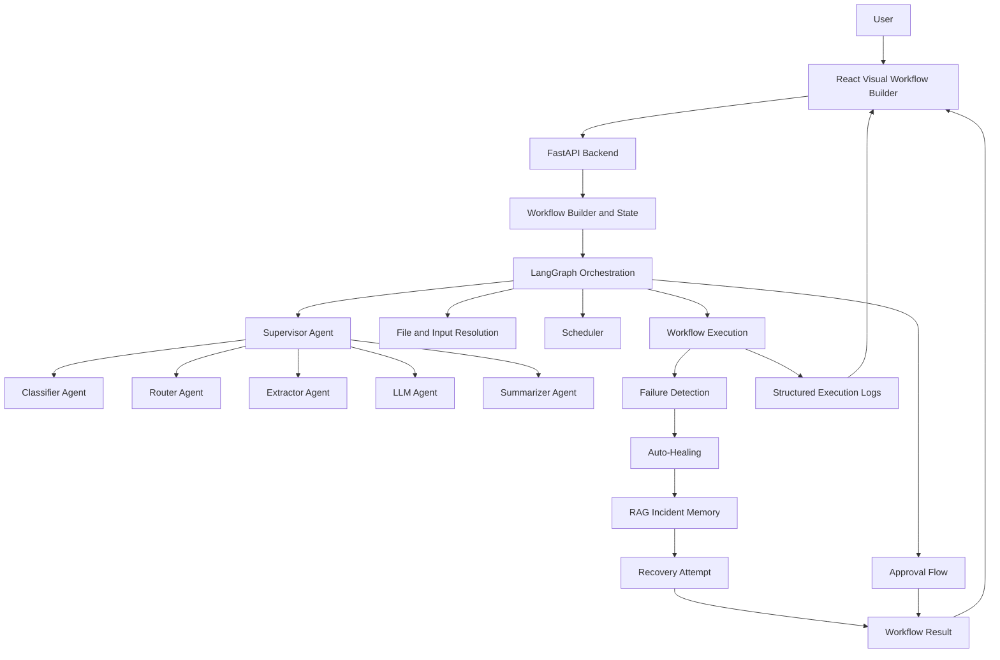

# 🛡️ SentinelMesh Studio
### Intelligent AI Workflow Automation Platform

> **Design workflows. Deploy intelligent agents. Recover from failures.**

SentinelMesh Studio is an intelligent AI-powered workflow automation platform that combines a visual workflow builder with autonomous AI agents. It enables users to design, execute, monitor, and manage workflows through a node-based interface while leveraging AI agents for task processing, decision-making, and failure recovery.

Unlike traditional automation systems that rely entirely on fixed rules and predefined execution paths, SentinelMesh Studio introduces context-aware AI processing, agent coordination, human approval mechanisms, and intelligent recovery capabilities.

---

## 🚀 Overview

SentinelMesh Studio brings together **visual workflow automation and Agentic AI** to create adaptable and resilient automation pipelines.

Users can construct workflows by connecting modular nodes through a visual canvas. The backend orchestrates workflow execution using specialized agents, allowing tasks to be processed intelligently rather than relying only on rigid predefined logic.

The platform also incorporates failure detection, auto-healing, structured execution logs, approval-based actions, file-based inputs, and workflow scheduling.

### 🎯 Vision

To transform conventional automation into intelligent workflows capable of understanding context, adapting to unexpected situations, and recovering from failures with minimal manual intervention.

---

## ❗ Problem Statement

Traditional workflow automation platforms are primarily rule-driven and depend on predefined execution paths.

When unexpected inputs, execution errors, or changing conditions occur, workflows may fail completely and require manual intervention.

This results in:

- Rigid automation with limited adaptability.
- Lack of contextual understanding.
- Difficulty managing complex workflows.
- Limited recovery from unexpected failures.
- Excessive dependency on manual monitoring.
- Fragmented integration between automation and AI capabilities.

---

## 💡 Our Solution

SentinelMesh Studio addresses these limitations through an AI-driven, agent-based workflow automation architecture.

The platform combines:

- **Visual Workflow Builder** for intuitive workflow design.
- **Agentic AI** for context-aware processing and task execution.
- **LangGraph** for orchestrating agent interactions.
- **MCP (Model Context Protocol)** for standardized tool integration.
- **Human-in-the-Loop** for approval of sensitive actions.
- **Failure Detection** for identifying execution issues.
- **Auto-Healing** for attempting recovery from workflow failures.
- **RAG-Based Incident Memory** for contextual recovery support.

---

## ✨ Key Features

### 🧩 Visual Workflow Builder
- Build workflows using a node-based canvas.
- Connect nodes to define task execution paths.
- Configure workflow node properties.
- Create new workflows and reset the canvas.
- Save and load workflows.
- Export workflows as JSON.
- Execute workflows directly from the interface.
- Use predefined workflow templates.

### 🤖 Agentic AI System

A collection of specialized AI agents collaborate to process workflow tasks.

| Agent | Responsibility |
|---|---|
| Supervisor Agent | Coordinates workflow execution and agent interactions |
| Classifier Agent | Classifies incoming tasks and identifies processing requirements |
| Router Agent | Determines appropriate task routing |
| Extractor Agent | Extracts useful information from inputs |
| LLM Agent | Performs AI-powered reasoning and processing |
| Summarizer Agent | Produces concise summaries |
| Approval Agent | Manages approval-based execution |
| Failure Detection Agent | Identifies workflow failures |
| Auto-Healing Agent | Attempts recovery from failed execution |
| Scheduler Agent | Handles scheduled workflow execution |

### 🔄 Intelligent Workflow Execution
- Dynamic execution of connected workflow nodes.
- Agent-based processing.
- Workflow state management.
- Execution output tracking.
- Structured execution logs.
- Handling of workflow dependencies and inputs.

### 🛠️ Failure Detection & Auto-Healing

Instead of treating every failure as a final stopping point, SentinelMesh Studio incorporates failure-handling mechanisms.

- Detect execution failures.
- Analyze failure context.
- Attempt recovery through auto-healing mechanisms.
- Utilize incident context where available.
- Support recovery-oriented execution.

### 🧠 RAG-Based Incident Memory

Retrieval-Augmented Generation capabilities help provide contextual information for workflow incidents and recovery scenarios.

The objective is to improve recovery decisions by using relevant incident knowledge instead of relying exclusively on isolated error messages.

### 🛡️ Human-in-the-Loop Approval

Sensitive actions can be placed behind an approval step.

- Approval-based execution flow.
- Human oversight before selected actions.
- Controlled continuation after approval.
- Improved safety for AI-driven automation.

### 📂 File Upload & Input Resolution

- Accept file-based inputs into workflows.
- Resolve inputs required by downstream nodes.
- Support data passing between workflow components.

### ⏰ Workflow Scheduling & Triggers

Supports scheduling and event-triggered workflow initiation, allowing workflows to be started based on configured conditions or triggers.

### 📊 Execution Monitoring

- View workflow execution progress.
- Track node execution.
- View structured execution information.
- Inspect execution outcomes and errors.

---

## 🏗️ Architecture

SentinelMesh Studio follows a modular architecture with a React frontend, FastAPI backend, workflow execution layer, and specialized AI agents.



---

## 🔧 Technology Stack

### Frontend

- React
- TypeScript
- Vite
- Node.js
- npm

### Backend

- Python
- FastAPI
- Uvicorn
- REST APIs

### AI & Orchestration

- LangGraph
- Large Language Models (LLMs)
- Agentic AI architecture
- Retrieval-Augmented Generation (RAG)

### Integration & Automation

- Model Context Protocol (MCP)
- Workflow-based orchestration
- Human-in-the-Loop approvals
- Event-driven automation

### Testing

- Pytest
- Backend agent testing
- Workflow execution testing
- Integration testing

---

## 📁 Project Structure

```text
SentinelMesh-Studio-Intelligent-AI-Workflows/
│
├── backend/
│   ├── agents/
│   │   ├── agent_registry.py
│   │   ├── approval.py
│   │   ├── auto_healing.py
│   │   ├── classifier_agent.py
│   │   ├── email_trigger.py
│   │   ├── extractor_agent.py
│   │   ├── failure_detection.py
│   │   ├── file_upload.py
│   │   ├── input_resolution.py
│   │   ├── inventory.py
│   │   ├── llm_agent.py
│   │   ├── rag_incident_memory.py
│   │   ├── router_agent.py
│   │   ├── scheduler_agent.py
│   │   ├── send_email_agent.py
│   │   ├── summarizer_agent.py
│   │   └── supervisor.py
│   │
│   ├── constants/
│   ├── graph/
│   ├── routes/
│   ├── services/
│   ├── tests/
│   ├── requirements.txt
│   └── debug_approve_run.py
│
├── frontend/
│   ├── src/
│   │   ├── components/
│   │   ├── hooks/
│   │   ├── services/
│   │   ├── templates/
│   │   ├── utils/
│   │   ├── types/
│   │   ├── App.tsx
│   │   └── nodeCapabilities.ts
│   │
│   ├── package.json
│   └── ...
│
└── README.md
```

---

## 🔌 Workflow Nodes

SentinelMesh Studio provides modular building blocks for constructing automation pipelines.

| Node | Purpose |
|---|---|
| Scheduler | Schedule workflow execution |
| Webhook | Trigger workflows from incoming events |
| File Upload | Provide file-based workflow input |
| Extractor | Extract information from input data |
| LLM | Perform intelligent AI processing |
| Summarizer | Summarize information |
| Loop | Support iterative processing |
| Failure Detection | Identify execution failures |
| Auto-Healing | Attempt failure recovery |
| Approval | Introduce human approval checkpoints |

---

## ⚙️ Installation & Setup

### Prerequisites

Install the following:

- Python 3.10+
- Node.js
- npm
- Git

### 1. Clone the repository

```bash
git clone https://github.com/YOUR_USERNAME/YOUR_REPOSITORY.git
cd YOUR_REPOSITORY
```

### 2. Backend Setup

Navigate to the backend directory:

```bash
cd backend
```

Create a Python virtual environment:

```bash
python -m venv .venv
```

Activate the environment.

**Windows PowerShell:**

```powershell
.\.venv\Scripts\Activate.ps1
```

**Linux / macOS:**

```bash
source .venv/bin/activate
```

Install dependencies:

```bash
pip install -r requirements.txt
```

Configure the required API keys and environment variables for your AI services.

Start the backend:

```bash
uvicorn main:app --reload --port 8000
```

Backend URL:

```text
http://localhost:8000
```

Health endpoint:

```text
http://localhost:8000/health
```

API documentation:

```text
http://localhost:8000/docs
```

### 3. Frontend Setup

Open another terminal.

Navigate to frontend:

```bash
cd frontend
```

Install dependencies:

```bash
npm install
```

Start the development server:

```bash
npm run dev
```

Frontend URL:

```text
http://localhost:5173
```

---

## ▶️ How to Use

### Step 1: Launch the Platform

Start the backend and frontend servers.

### Step 2: Create a Workflow

Create a new workflow from the visual workflow builder.

### Step 3: Add Nodes

Select the required nodes from the node library and place them on the workflow canvas.

### Step 4: Configure & Connect

Configure node properties and connect nodes to define the execution flow.

### Step 5: Execute

Click **Execute Workflow** to initiate the workflow.

### Step 6: Monitor

Monitor execution through the workflow interface and execution logs.

### Step 7: Handle Failures

When an execution failure occurs, the failure detection and auto-healing mechanisms can attempt recovery.

### Step 8: Approval

If an approval checkpoint is configured, review and approve the action before execution continues.

---

## 🧪 Testing

Backend tests are implemented using Pytest.

Run tests from the backend directory:

```bash
pytest
```

Run a specific test:

```bash
pytest tests/test_supervisor_agent.py
```

Example test modules include:

- Agent tests.
- Approval agent tests.
- Extractor tests.
- Failure detection tests.
- Graph builder tests.
- Router tests.
- Supervisor tests.
- Scheduler tests.
- File upload and downstream input resolution tests.

---

## 🌟 Our USP

- **Visual + Agentic Automation:** Combines visual workflow design with autonomous AI agents.
- **Context-Aware Processing:** AI agents process tasks using contextual information instead of only fixed rules.
- **MCP Integration:** Enables standardized connections between AI agents and external tools.
- **Human Oversight:** Sensitive actions can require approval.
- **Resilient Workflows:** Failure detection and auto-healing help workflows recover from unexpected errors.
- **Incident-Aware Recovery:** RAG-based incident memory supports context-aware recovery.
- **Modular Design:** Agents and nodes can be expanded as the platform evolves.

---

## 🔮 Future Scope

- Expanded MCP tool ecosystem.
- Calendar integration.
- Database workflow nodes.
- HTTP/API nodes.
- Advanced retry and recovery strategies.
- Persistent workflow execution history.
- Workflow version control.
- Multi-user collaboration.
- Advanced analytics and monitoring.
- Improved long-term agent memory.

---

## 🚧 Project Status

**Status: Active Development**

SentinelMesh Studio is currently being developed and enhanced. Features and architecture may evolve as new agents, integrations, and workflow capabilities are introduced.

---

## 👥 Team

Developed as an AI workflow automation project.

*Add team members and contributor details here.*

---


<div align="center">

### SentinelMesh Studio

**Intelligent workflows that understand, adapt, and recover.** 🛡️

</div>
